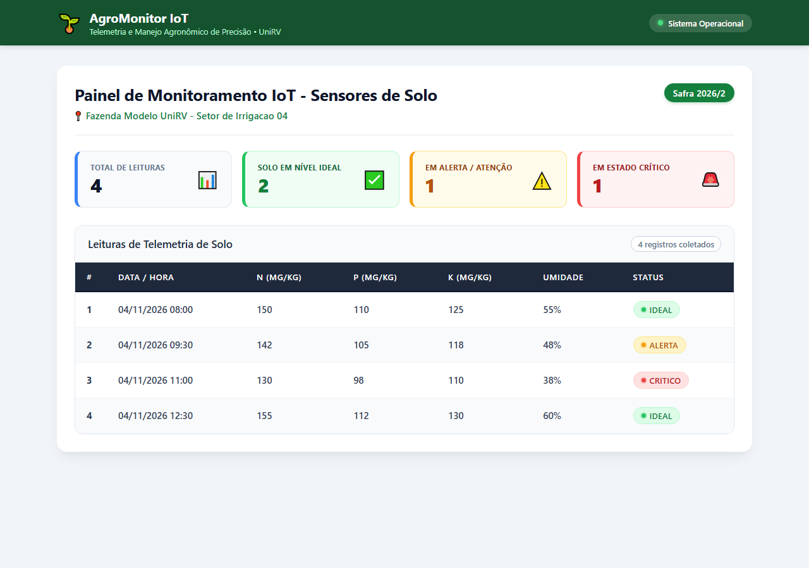

# AgroMonitor IoT - Agro-Sensor-Web 🌱

> **Prática de Laboratório — Desenvolvimento Web**  
> **Professor:** Me. Sergio Souza Novak  
> **Instituição:** Universidade de Rio Verde (UniRV)  
> **Curso:** Faculdade de Engenharia de Software / Ciência da Computação  
> **Tema:** Frameworks Front-End e Fundamentos do Angular  
> **Atividade:** Criação de Projeto Angular e Componente de Sensores IoT  

---

## 👨‍🎓 Identificação do Aluno

* **Nome Completo:** Fabiano
* **Matrícula UniRV:** *[Preencha aqui com sua matrícula]*
* **Curso:** Engenharia de Software / Ciência da Computação
* **Instituição:** UniRV – Universidade de Rio Verde

---

## 🌾 Sobre o Projeto

O **AgroMonitor IoT** é uma aplicação Single Page Application (SPA) desenvolvida com **Angular** e **TypeScript** para o monitoramento agrícola inteligente de precisão. O sistema exibe e avalia telemetrias físico-químicas de solo (Nitrogênio - N, Fósforo - P, Potássio - K e Umidade), categorizando a situação operacional das lavouras em status (*Ideal*, *Alerta* e *Crítico*).

### Funcionalidades Implementadas
- **Tipagem Forte no TypeScript:** Interface `LeituraSolo` para controle rigoroso dos atributos dos sensores.
- **Componentização Modular:** Componente dedicado `container-tabela` gerado via Angular CLI.
- **Interpolação e Diretivas:** Uso de interpolação reativa de dados e diretiva `*ngFor` para renderização da lista de leituras.
- **Interface e UX Moderna:** Tabela com linhas alternadas (*zebra*), bordas suaves, distintivos visuais coloridos (*badges*) e cards de indicadores rápidos (KPIs) conforme os protótipos de referência da atividade.

---

## 📸 Captura de Tela (Execução em http://localhost:4200)

Abaixo está a captura de tela da tabela de sensores renderizada no navegador:



---

## 🚀 Instruções de Instalação e Execução

### Pré-requisitos
* **Node.js** (versão 18+ ou 20+)
* **NPM** instalado
* **Angular CLI** (opcional para execução global, ou utilize via npx)

### 1. Clonar o Repositório
```bash
git clone https://github.com/<seu-usuario>/agro-sensor-web.git
cd agro-sensor-web
```

### 2. Instalar as Dependências
Instale todos os pacotes e dependências do projeto através do npm:
```bash
npm install
```

### 3. Iniciar o Servidor de Desenvolvimento
Inicie o servidor de desenvolvimento local:
```bash
ng serve --open
```
> Caso não tenha o Angular CLI instalado globalmente, execute:
> ```bash
> npx ng serve --open
> ```

A aplicação estará disponível no navegador através do endereço:  
👉 **`http://localhost:4200`**

---

## 🛠️ Fases de Implementação e Histórico de Commits

O repositório foi construído seguindo rigorosamente as etapas do roteiro acadêmico, com histórico de commits descritivos:

1. `feat: define interface LeituraSolo para tipagem de sensores` (Etapa 2)
2. `feat: gera componente container-tabela via Angular CLI` (Etapa 3)
3. `feat: implementa logica e dados de telemetria no container-tabela` (Etapa 4)
4. `feat: implementa template HTML e estilizacao zebra com badges coloridos e KPIs` (Etapa 5)
5. `feat: integra componente container-tabela ao componente raiz app.component` (Etapa 6)
6. `docs: adiciona README com identificacao, instrucoes e screenshot da aplicacao` (Etapa 7)

---

## 📂 Estrutura de Diretórios

```plaintext
agro-sensor-web/
├── docs/
│   └── screenshot.png                     # Captura de tela da aplicação em execução
├── src/
│   ├── app/
│   │   ├── container-tabela/              # Componente modular da tabela
│   │   │   ├── container-tabela.component.css
│   │   │   ├── container-tabela.component.html
│   │   │   ├── container-tabela.component.spec.ts
│   │   │   └── container-tabela.component.ts
│   │   ├── interfaces/                    # Definições de tipagem TypeScript
│   │   │   └── sensores.interface.ts
│   │   ├── app.component.css
│   │   ├── app.component.html             # Componente raiz com a barra de navegação
│   │   ├── app.component.spec.ts
│   │   └── app.component.ts
│   ├── index.html
│   ├── main.ts
│   └── styles.css                         # Estilos globais
├── angular.json
├── package.json
├── tsconfig.json
└── README.md
```
